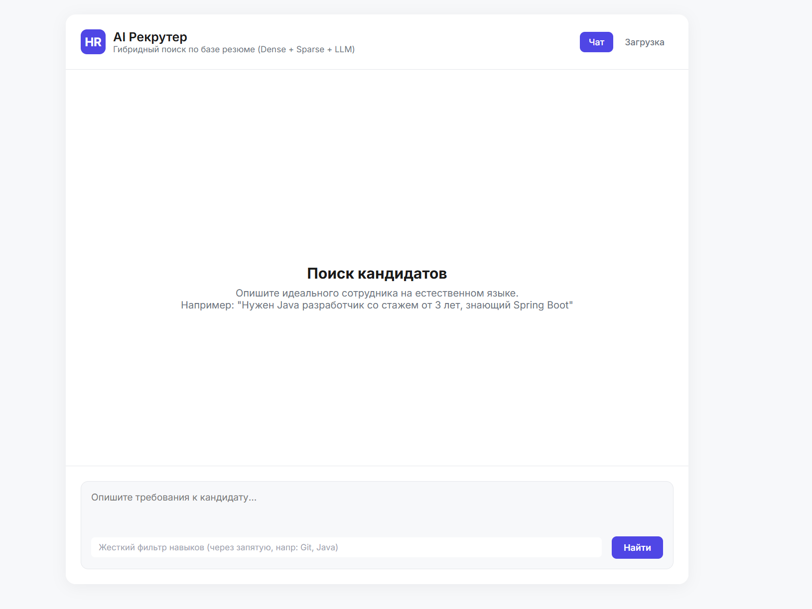
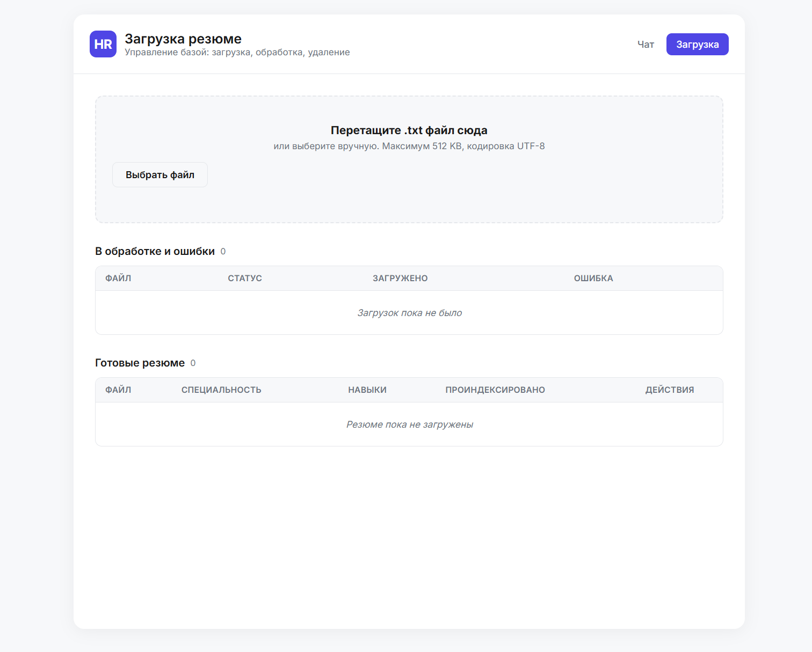
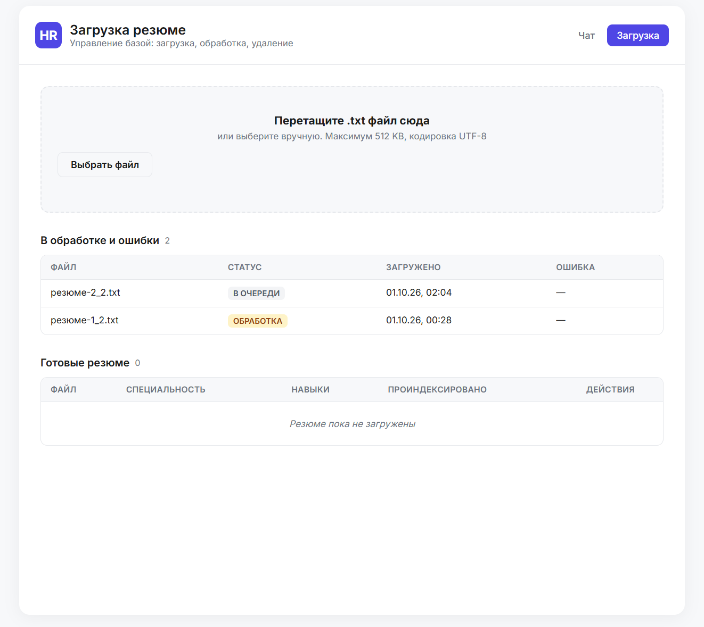
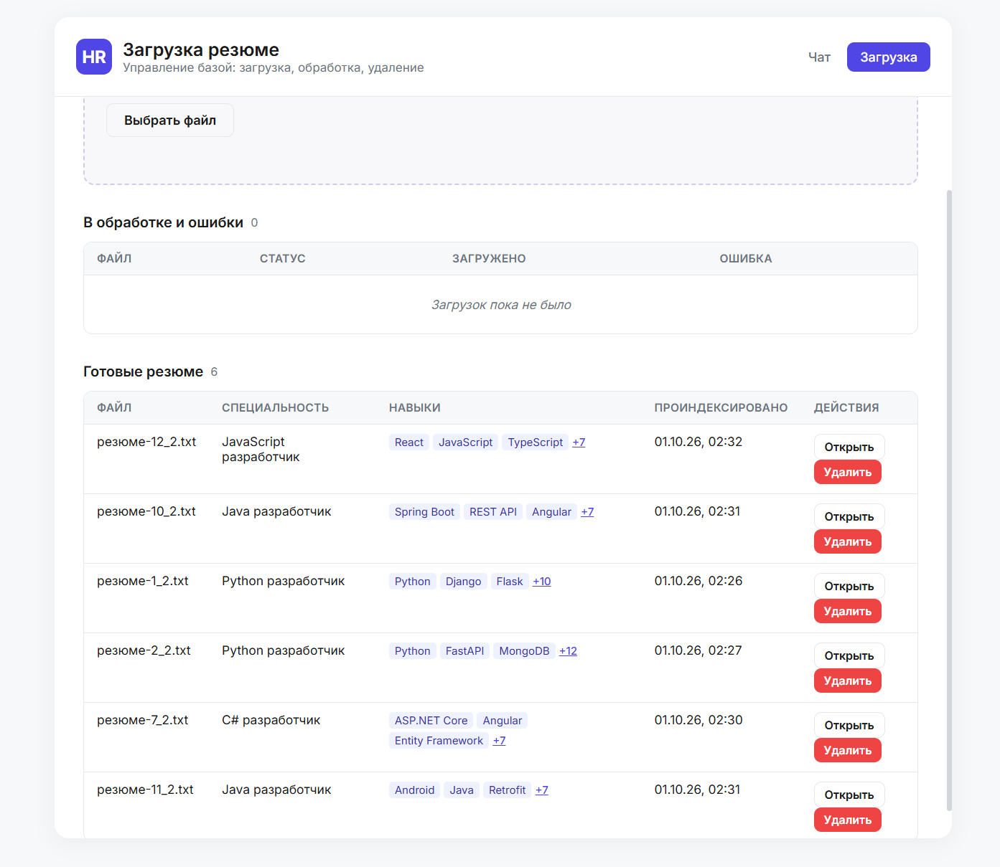
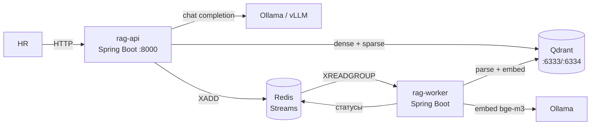

# AI Resume RAG System (Java)

[](https://openjdk.org)
[](https://spring.io/projects/spring-boot)
[](https://spring.io/projects/spring-ai)
[](https://qdrant.tech)
[](https://redis.io)
[](https://docker.com)
[](#llm-бэкенды)

Система семантического поиска и анализа резюме на базе RAG. Гибридный поиск (dense BGE-M3 + sparse BM25) в Qdrant, асинхронная обработка через Redis Streams, локальная LLM (Ollama или vLLM) для генерации ответов. Всё работает в Docker, разворачивается одной командой.

## Скриншоты

<table>
  <tr>
    <td></td>
    <td></td>
  </tr>
  <tr>
    <td align="center"><b>Чат с AI-рекрутером</b></td>
    <td align="center"><b>Загрузка резюме</b></td>
  </tr>
  <tr>
    <td></td>
    <td></td>
  </tr>
  <tr>
    <td align="center"><b>Очередь и статусы в реальном времени</b></td>
    <td align="center"><b>Список готовых резюме</b></td>
  </tr>
</table>

## Архитектура



Один артефакт (JAR) запускается в двух ролях: профиль `api` поднимает web-сервер, профиль `worker` разбирает очередь. Это прямой аналог прежнего разделения `api` + `parser-worker`.

## Сервисы

| Сервис | Роль | Профиль |
|--|--|--|
| `qdrant` | Векторная БД: dense (1024) + sparse BM25 | default |
| `redis` | Redis Streams (очередь) + статусы задач | default |
| `rag-api` | REST, статика, постановка задач, поиск | default |
| `rag-worker` | Разбор очереди: текст → поля → эмбеддинг → Qdrant | default |
| `ollama` | LLM и модель эмбеддингов bge-m3 | `ollama-docker` |
| `vllm` | LLM на GPU (production-профиль) | `vllm` |

## Поток данных

1. **Приём** — `POST /api/resumes/upload`: файл сохраняется в `resumes/`, создаётся задача `queued`, в Stream уходит `XADD`. API сразу отвечает `202 Accepted`.
2. **Извлечение текста** — по содержимому файла определяется формат (txt/pdf/docx/rtf), затем извлекается plain text (PDFBox, POI, собственный RTF-разбор).
3. **Разбор** — текст нормализуется и разбирается в поля: имя, пол, должность, опыт (компания, город, должность, период, описание), образование, навыки.
4. **Валидация** — обязательны должность, хотя бы одно место работы и непустой список навыков; иначе задача переходит в `failed` с понятной причиной.
5. **Эмбеддинг** — нормализованный полный текст резюме кодируется BGE-M3 (Ollama, 1024).
6. **Индексация** — точка с двумя векторами (dense + sparse BM25) и payload загружается в Qdrant.
7. **Поиск** — `POST /search`: dense и sparse ищутся параллельно на стороне Qdrant, результаты объединяются через RRF, топ-K уходит в LLM.
8. **Асинхронность** — статусы (`queued → processing → indexed/failed`) пишутся в Redis hash, UI видит прогресс через polling.

## Поддерживаемые форматы резюме

| Формат | Как читается |
|--|--|
| `.txt` | напрямую, только UTF-8 (иначе `422`) |
| `.pdf` | PDFBox 3.x (текстовый PDF; сканы без OCR не поддерживаются) |
| `.docx` | Apache POI (XWPF) |
| `.rtf` | собственный разбор: `\uNNNN`, `\ucN`, пропуск `\pict` и колонтитулов |

Формат определяется **по содержимому, а не по расширению**: на практике встречается RTF, сохранённый под именем `.doc`, и такой файл распознаётся корректно. Бинарный Word 97-2003 (OLE2) не поддерживается.

Ожидаемый формат — выгрузка hh.ru. Обязательные разделы: `Желаемая должность и зарплата`, `Опыт работы`, `Навыки`. Старый шаблон («Название специальности:») отвергается с `422`.

## Ключевые особенности

* **Гибридный поиск** — dense (BGE-M3) + sparse BM25, объединение через Reciprocal Rank Fusion. Находит синонимы, но не пропускает точные названия технологий («Spring Boot», «CI/CD»).
* **BM25 считается в Java** — Qdrant OSS для генерации sparse-векторов по тексту требует отдельный inference-сервис, поэтому лексические веса считаются приложением, а IDF остаётся за Qdrant (`modifier: idf`). Инфраструктура остаётся из двух сервисов.
* **Дедупликация по содержимому** — id точки детерминированный: UUID от `sha256` нормализованного текста. Одно и то же резюме в `txt`, `pdf` и `docx` даёт **один** id, повторная загрузка перезаписывает точку, а не создаёт дубль.
* **Текст для эмбеддинга не зависит от формата** — в вектор уходит нормализованный текст, собранный из распознанных блоков, поэтому `.txt` и `.pdf` одного резюме дают эквивалентный результат (проверено тестами).
* **Асинхронная обработка** — Redis Streams с consumer group: `XACK` только после успешной обработки (аналог `task_acks_late`), повторы с ограничением попыток и отдельный DLQ-stream.
* **Мягкая валидация содержимого** — проверяются только обязательные разделы; всё остальное (контакты, формат работы, «обо мне») остаётся в тексте и участвует в поиске.
* **Fail-fast на старте** — приложение проверяет Redis и Qdrant при запуске и падает с понятной ошибкой, а не работает молча.
* **LLM-бэкенды** — единый OpenAI-совместимый клиент (Ollama `/v1`, vLLM) или нативный Ollama; переключение через переменные окружения.

## Быстрый старт

### Требования

* Docker & Docker Compose
* Ollama на хосте (режим по умолчанию) и модели:
  ```bash
  ollama pull bge-m3          # эмбеддинги, 1024
  ollama pull qwen2.5:1.5b    # чат; для качества взять модель крупнее
  ```

### 1. Настройка

```bash
cp .env.example .env
# при необходимости поменяйте LLM_MODEL и OLLAMA_BASE_URL
```

### 2. Запуск

```bash
docker compose up -d --build
```

Поднимутся `qdrant`, `redis`, `rag-api`, `rag-worker`. Откройте http://localhost:8000

### 3. Индексация резюме

**Вариант A — через UI:** откройте http://localhost:8000/upload и перетащите файлы.

**Вариант B — массовая переиндексация каталога:**

```bash
curl -X POST "http://localhost:8000/api/admin/reindex?confirm=true"
```

⚠️ По умолчанию (`recreate_collection=true`) коллекция Qdrant **пересоздаётся**: старый индекс удаляется. Это нужно после смены модели эмбеддингов или схемы payload — старые и новые векторы иначе несопоставимы.

### 4. Использование

Откройте http://localhost:8000 и опишите требования к кандидату:

> Нужен Java разработчик со Spring Boot и Kafka

При необходимости укажите жёсткий фильтр по навыкам: `Java, Spring`.

## API

| Метод | Путь | Назначение |
|--|--|--|
| `POST` | `/search` | RAG-поиск: retrieval + генерация ответа LLM |
| `POST` | `/api/resumes/upload` | Загрузка файла → `202 Accepted` + `task_id` |
| `GET` | `/api/resumes` | Список готовых резюме |
| `GET` | `/api/resumes/{id}` | Полная карточка резюме |
| `GET` | `/api/resumes/{id}/file` | Скачивание оригинала |
| `DELETE` | `/api/resumes/{id}` | Удаление (Qdrant + файл + задача) |
| `GET` | `/api/tasks` | Статусы задач (`include_indexed=true` — все) |
| `POST` | `/api/admin/reindex` | Полная переиндексация каталога |
| `GET` | `/health`, `/actuator/health` | Проверка живости |

### Пример `/search`

```json
POST /search
{
  "query": "Нужен Java разработчик со Spring Boot и Kafka",
  "top_k": 5,
  "required_skills": ["Java", "Spring"]
}
```

Ответ:

```json
{
  "answer": "### 🟢 Зелёный\n\n**Иванов Иван** — Java разработчик...",
  "found_resumes_count": 5
}
```

Ошибки отдаются в формате `{"detail": "..."}`.

## LLM-бэкенды

| Режим | `.env` | Запуск |
|--|--|--|
| Локальная Ollama (дефолт) | `OLLAMA_BASE_URL=http://host.docker.internal:11434`, `LLM_BACKEND_URL=http://host.docker.internal:11434/v1` | `docker compose up -d` |
| Ollama в Docker | `OLLAMA_BASE_URL=http://ollama:11434`, `LLM_BACKEND_URL=http://ollama:11434/v1` | `docker compose --profile ollama-docker up -d` |
| vLLM (GPU ≥ compute 7.0, ≥ 8GB VRAM) | `LLM_BACKEND_URL=http://vllm:8000/v1`, `LLM_MODEL=Qwen/Qwen2.5-7B-Instruct-AWQ` | `docker compose --profile vllm up -d` |

Эмбеддинги во всех режимах считает Ollama (`bge-m3`): vLLM их не отдаёт.

## Конфигурация

| Переменная | Назначение | По умолчанию |
|--|--|--|
| `REDIS_URL` | Redis: очередь и статусы | `redis://localhost:6379/0` |
| `QDRANT_HOST`, `QDRANT_GRPC_PORT` | Qdrant по gRPC (не REST-порт 6333) | `localhost`, `6334` |
| `QDRANT_COLLECTION` | Имя коллекции | `resumes` |
| `RESUMES_DIR` | Каталог с резюме | `./resumes` |
| `OLLAMA_BASE_URL` | Ollama для эмбеддингов | `http://localhost:11434` |
| `EMBEDDING_MODEL` | Модель эмбеддингов | `bge-m3` |
| `LLM_BACKEND_URL`, `LLM_MODEL`, `LLM_API_KEY` | Chat-бэкенд (OpenAI-совместимый) | Ollama `/v1`, `qwen2.5:1.5b` |
| `LLM_BACKEND` | `openai` или `ollama` | `openai` |

Длину контекста модели эмбеддингов задаёт сам Ollama: `OLLAMA_CONTEXT_LENGTH` в compose (`8192`). Ollama молча усекает слишком длинный вход, поэтому лимит выставляется на её стороне.

## Локальный запуск без Docker

```bash
cd rag
./mvnw package
java -jar target/rag-hr.jar --spring.profiles.active=api,local      # API на :8000
java -jar target/rag-hr.jar --spring.profiles.active=worker,local   # воркер
```

Профиль `local` задаёт пути относительно корня репозитория и адреса локальных Redis/Qdrant/Ollama.

## Тесты

```bash
cd rag
./mvnw test
```

Покрыто:

* **Golden-корпус** (`resumes/samples`) — 4 резюме, каждое в трёх форматах (txt/docx/pdf):
  * каждый файл разбирается и содержит обязательные разделы;
  * **все форматы одного резюме дают идентичный разбор и идентичный текст для эмбеддинга**;
  * краевые случаи: дублирующийся заголовок «Навыки», блок опыта без компании, город, приписанный к компании.
* **Парсер** — поля эталонной выгрузки, оба порядка «компания до дат» / «после дат», отказ при отсутствии обязательных разделов, отказ старого шаблона, CRLF/BOM, не-UTF-8 файл.
* **Извлечение** — определение формата по содержимому, RTF (кириллица, тире, картинки, гиперссылки), PDF, DOCX.

Корпус можно пересобрать из текстовых образцов:

```bash
./mvnw test -Dtest=FixtureGeneratorTest -Drag.generate-fixtures=true
```

## Структура проекта

```
.
├── rag/                              # Java-приложение (Maven, Spring Boot)
│   ├── pom.xml
│   ├── Dockerfile
│   └── src/main/java/com/github/reactivity512/rag/
│       ├── RagApiApplication.java     # точка входа API
│       ├── RagWorkerApplication.java  # точка входа воркера
│       ├── api/                       # REST: поиск, резюме, задачи, админ
│       ├── config/                    # конфигурация, health-gate
│       ├── embedding/                 # клиент Ollama (/api/embed, bge-m3)
│       ├── indexing/                  # payload, оркестрация индексации
│       ├── ingest/                    # извлечение текста и разбор полей
│       │   ├── extract/               # txt/pdf/docx/rtf + определение формата
│       │   ├── parse/                 # парсер hh-выгрузки
│       │   └── domain/                # модель резюме
│       ├── queue/                     # Redis Streams: publisher, consumer, DLQ
│       ├── search/                    # гибридный поиск + вызов LLM
│       ├── status/                    # статусы задач в Redis
│       ├── storage/                   # оригиналы файлов
│       └── vector/                    # Qdrant: схема, upsert, поиск, BM25
├── resumes/
│   └── samples/                       # golden-корпус: txt + docx + pdf
├── docker-compose.yml
├── .env.example
└── docs/screenshots/
```

## Технические решения

### Почему BM25 считается в Java, а не в Qdrant

Qdrant умеет генерировать sparse-вектор из текста моделью `qdrant/bm25`, но в OSS-сборке для этого нужен внешний inference-сервис (`INFERENCE__URL`). Это добавляло бы третий контейнер к Qdrant и Redis, поэтому лексические веса считаются приложением:

* в вектор документа попадает насыщенная частота терма с нормализацией по длине (часть формулы Okapi BM25, `k1 = 1.2`, `b = 0.75`, `avg_len = 256` — дефолты Qdrant);
* IDF остаётся за Qdrant через `modifier: idf`, поэтому итоговые скоры по-прежнему сопоставимы между документами.

Такой же компромисс использует FastEmbed. Альтернатива — поднять inference-контейнер и вернуться к серверному `qdrant/bm25`.

### Почему BGE-M3, а не E5

У E5 жёсткий лимит 512 токенов: резюме с опытом легко его превышают, и всё лишнее обрезается молча. BGE-M3 держит 8192 токена — это ~6000 слов, то есть резюме целиком, без чанкинга и потери связи между секциями.

| Критерий | E5-large | BGE-M3 |
|--|--|--|
| Контекст | 512 токенов | 8192 токена |
| Префиксы | `query:` / `passage:` обязательны | не требуются |
| Мультиязычность | 100+ языков | 100+ языков |

### Почему одно резюме — одна точка

Резюме — связный документ: опыт, навыки и образование дополняют друг друга. Нарезка на чанки по 512 токенов ломает эти связи. BGE-M3 с контекстом 8192 токена позволяет индексировать резюме целиком, а LLM получает полный текст, а не фрагмент.

### Почему Redis Streams вместо Celery

Парсинг и эмбеддинг занимают секунды, поэтому нужна асинхронная очередь с надёжной доставкой. Redis уже используется для статусов, а Streams дают всё необходимое без нового сервиса:

* `XADD` / `XREADGROUP` / `XACK` — доставка «как минимум один раз» с подтверждением после обработки;
* consumer group — несколько воркеров делят нагрузку;
* `XPENDING` — незавершённые задачи не теряются при падении воркера;
* отдельный DLQ-stream — задачи, исчерпавшие попытки.

Обработка идемпотентна: id точки детерминированный, поэтому повторный разбор перезаписывает ту же точку.

### Почему текст для эмбеддинга нормализуется

Один и тот же документ в `txt` и `pdf` приходит по-разному: у PDF другой порядок строк, колонтитул попадает в середину текста, даты разорваны, «Навыки» склеены со списком. Если эмбеддить сырой текст, одно резюме даст разные векторы, а дедупликация станет невозможной. Поэтому текст собирается из уже распознанных блоков — тест `GoldenCorpusTest` проверяет, что все три формата дают идентичный результат.

### Почему OpenAI-совместимый API для LLM

Ollama (`/v1`), vLLM и облачные провайдеры поддерживают Chat Completions API. Один клиент — три бэкенда, переключение переменной окружения. Нативный Ollama-чат тоже настроен и включается через `LLM_BACKEND=ollama`.

## Known limitations

| Ограничение | Причина | План |
|--|--|--|
| Только текстовые PDF | Нет OCR | Tesseract для сканов |
| Нет чанкинга | Резюме укладываются в 8192 токена | Чанкинг с `resume_id` для гигантских документов |
| Нет реранкера | Топ-K идёт в LLM как есть | Cross-encoder после гибридного поиска |
| Нет пагинации `/api/resumes` | `limit=100` по умолчанию | `next_offset` через Qdrant scroll |
| Дубли в golden-корпусе | Три формата одного резюме | Это осознанно: так проверяется дедупликация |
| `education` может быть пустым | В PDF-выгрузке блока может не быть | Не ошибка: раздел необязательный |
| Качество `qwen2.5:1.5b` | Маленькая модель для быстрых локальных прогонов | vLLM + 7B-AWQ |

## Roadmap

- Eval-датасет + recall@k: golden-набор запросов с аннотированной релевантностью (Recall@5, MRR).
- Реранкер — cross-encoder для топ-20 после гибридного поиска.
- OCR для сканированных PDF.
- Чанкинг для резюме длиннее 8192 токенов.
- Streaming LLM-ответов — SSE.
- Аутентификация — Basic Auth или JWT.
- Нативный sparse BGE-M3 — заменить локальный BM25 на lexical weights модели.
- Формальные бенчмарки — TTFT и throughput на Ollama CPU и vLLM GPU.

## Лицензия

MIT
